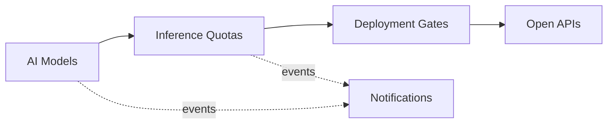

# Domain Model and Bounded Contexts

Ubiquitous language and context design (view VP-4). Domain-standard concepts are mapped
normatively in `../domain/domain-standards.md` (CR-5).

## Ubiquitous language (selected terms)

| Term | Meaning |
|---|---|
| **AI model** | A registered model (framework, owner team) with a lifecycle |
| **Inference quota** | A team's guarded token/compute budget account |
| **Inference usage** | One consumption record against a team's budget, by usage type |
| **Deployment gate** | A decision rule binding a risk tier to evaluation-score and incident envelopes |
| **Dataset** | A catalogued dataset (metadata only — never content) |
| **Drift score** | A transparent 0-100 model-drift and quality risk score |

## Bounded contexts and invariants

### AI Models — `model-service`
AI model registry with lifecycle governance. Lifecycle: `REGISTERED` → transitions
approve, retire. Prompts and training data are content, not platform data: this core records models, datasets (metadata only), budgets and verdicts — never prompt or payload content. All data is synthetic.

### Inference Quotas — `inference-quota-service`
Guarded inference/training budgets per team and the usage records against them. **Invariant (ADR-0004): inference and training consumption against a team's budget never exceeds that budget — a usage record that would overrun it is rejected (422) and records nothing, so AI spend is always controlled and evidenced.** Consumption records are
append-only evidence; a rejected operation records nothing.

### Deployment Gates — `deployment-gates-service`
Risk-tiered deployment gates: evaluation-score floors and incident envelopes, with reasons. Only ACTIVE rules decide; evaluation order is by priority; every decision
is ALLOWED / DEGRADED / DENIED with the matched rule and a human-readable reason.

### Datasets — `dataset-catalog-service`
Dataset catalogue — metadata only, never content.

### Notifications — `notification-service`
Delivery trail for audit; recipients are never logged.

## Context map

